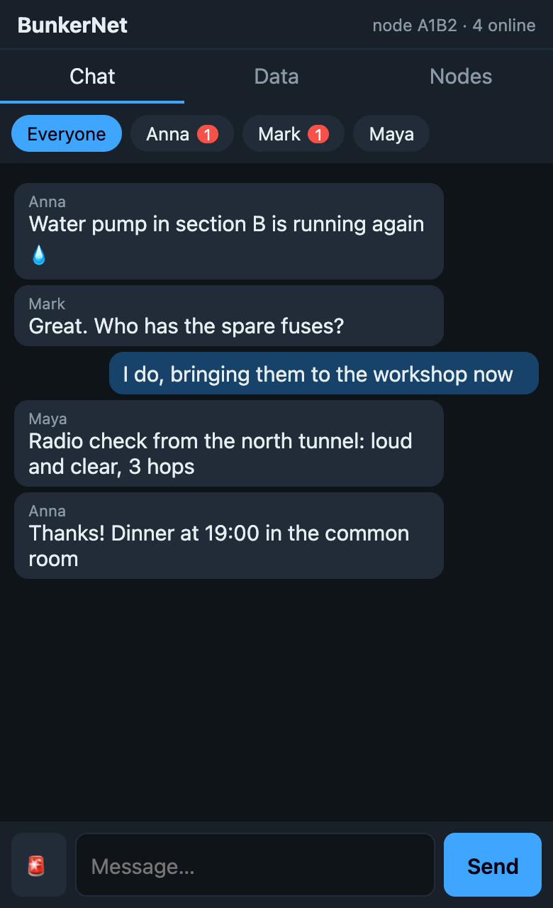
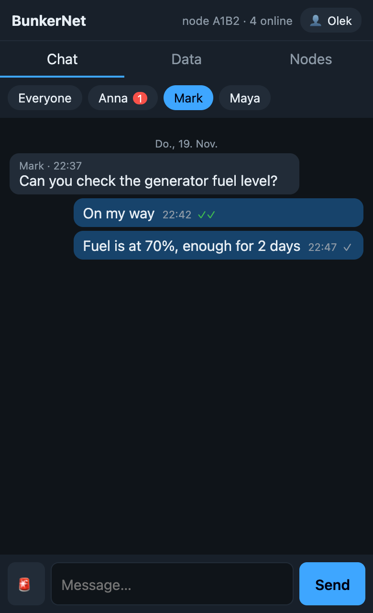
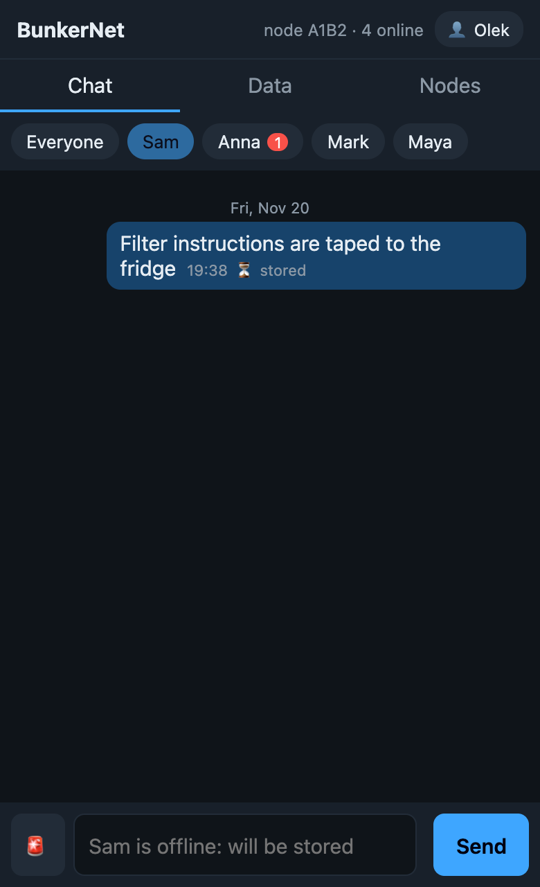
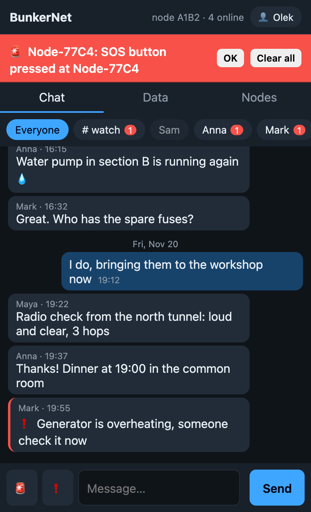
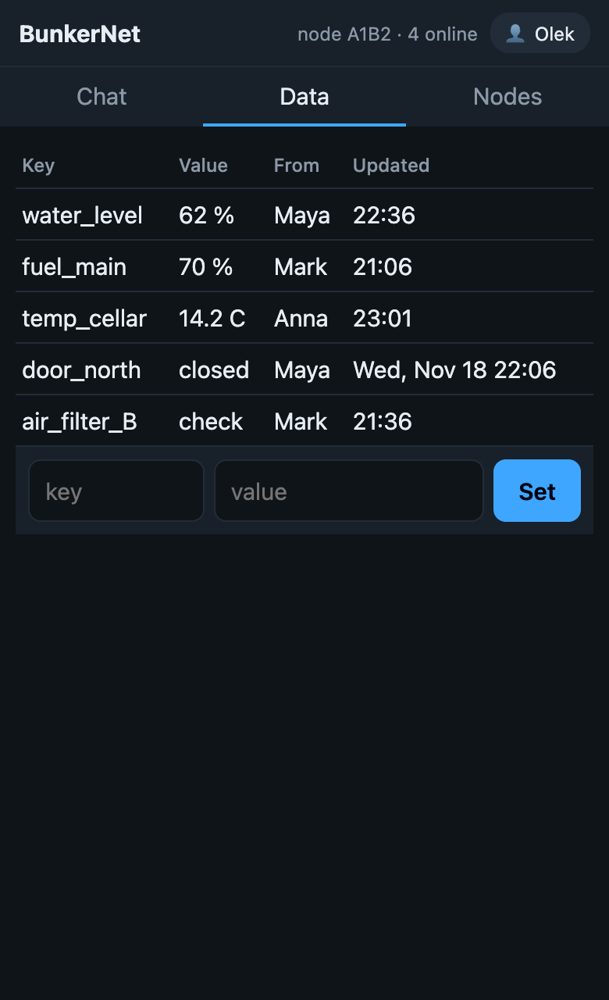
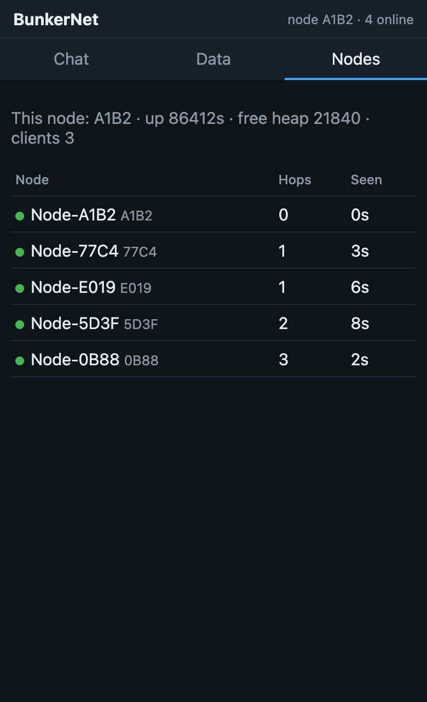

# BunkerNet

[](https://github.com/gumslone/bunkernet/actions/workflows/ci.yml)
[](LICENSE)

An offline, self-healing communication mesh for cheap **ESP-01 / ESP8266** modules. It works
with no internet, no router and no app install.

Place a few modules around a building and plug them in. Phones and laptops join the Wi-Fi
network `BunkerNet`, a page opens automatically, and everyone can chat, send private
messages, share data and raise alarms. It was designed for a bunker or "no infrastructure"
scenario, but it works equally well for a cabin, a festival or a blackout.

## Features

- **Group chat and private messages**, with delivery ticks (✓ sent, ✓✓ delivered), plus
  **time stamps and date separators** on every message.
- **Your name:** the first time you open the page it asks for a name, saved in your browser.
  Tap your name at the top right to change it at any time.
- **Store-and-forward:** send a private message to someone who is offline and it is held by the
  mesh and delivered the moment they next open the page, on any node, even hours later.
  The sender sees ⏳ *stored* until the delivery receipt (✓✓) arrives.
- **Emergency alerts:** a red banner with sound and vibration on every device on every node,
  repeated for about 5 minutes so briefly-offline nodes still get it. Optional **hardware SOS
  button** (hold 2 s).
- **Shared data board:** small key/value entries such as `water_level = 40%`, readable and
  writable from the web page or through the HTTP API (for sensors and scripts).
- **Node map:** which nodes are alive and how many hops away, to help you place them.
- **Encrypted mesh:** every packet is ChaCha20-Poly1305 encrypted and authenticated with a
  pre-shared key (stretched with PBKDF2). Replayed and duplicate packets are rejected.
- **Private means private:** each person's id is protected by a secret token kept in their
  browser, so another user on the same node can't read their private messages or pose as them.
- **Survives power cuts:** stored messages, identity claims and the boot counter are kept in
  the node's flash.
- **Relay-only nodes:** a build with no access point or web server, to extend range cheaply.
- **Self-healing:** no routing tables and no links to break. If a node dies, packets take
  another path.
- **Roaming:** every node uses the same SSID and address (192.168.4.1), so a phone moves to
  the nearest node as you walk.
- **Zero dependencies:** only the stock ESP8266 Arduino core. The web app is embedded in the
  firmware, with no CDN calls and nothing fetched at runtime.

## Screenshots

The web app is served by every node and works in any phone or laptop browser.

| Group chat | Private chat | Stored for offline user |
|:--:|:--:|:--:|
|  |  |  |

| Emergency alert | Data board | Node map |
|:--:|:--:|:--:|
|  |  |  |

*Screenshots show the real web page with sample data from a mock node. Regenerate them with
`node tools/screenshots/shoot.js` (needs Node 22+ and Chrome).*

## How it works

```
 phone ──Wi-Fi──► node A ◄──ESP-NOW (encrypted flood)──► node B ──Wi-Fi──► laptop
                     ▲                                      ▲
                     └──────────── node C ──────────────────┘
```

- **Backbone:** ESP-NOW broadcast flooding on one fixed channel. Every packet carries a hop
  limit (TTL) and a nonce of origin, boot counter and sequence number. Each node tracks the
  newest sequence number per origin (with a 32-packet window), which drops duplicates and
  rejects recorded packets that are replayed later. New packets are relayed after a small
  random delay to avoid collisions. Periodic traffic (node announcements, presence) is not
  relayed when neighbours already did it, and node announcements travel at most 4 hops, which
  keeps large meshes from drowning in their own chatter. Chat, private messages, data and
  alerts are always relayed.
- **Access:** every node is a soft access point on the same channel, with a captive portal
  that serves the web app. The page polls the node over HTTP, so any browser works.
- **Identity:** the browser generates a random id plus a secret token and asks for a display
  name, all kept in local storage. Private messages are addressed to the id, so renaming never
  breaks a chat. The first time an id appears, the node keeps a short hash of its token and
  floods that claim to the other nodes. From then on every request for that id must present
  the token. Names are not unique and nothing stops two people choosing the same one.
- **Time:** the nodes have no clock (an ESP8266 has no battery-backed RTC), so each message
  carries the sender's own phone or laptop time, and everyone sees the same stamp. If a
  device's clock is wrong its messages will show the wrong time.
- **Store-and-forward:** every node keeps a copy of each private message (a 12-message
  mailbox) until a delivery receipt for it is seen. When the recipient next opens the page on
  any node, that node hands over the message and floods the receipt, so all other nodes
  drop their copy. The node that originated a message also re-sends it on a back-off schedule
  (30 s, 1 min, 2 min, 5 min … up to about 10 hours) so nodes that were off or out of range
  catch up. The browser remembers people it has seen, so you can message someone who is
  currently offline. The mailbox and identity claims are saved to flash (at most once a
  minute), so they also survive a power cut.
- **Delivery receipts:** a private message is acknowledged when the recipient's device
  actually fetches it, and the receipt floods back to the sender's node.

## Quick start

You need: one or more ESP-01 / ESP8266 boards, a 3.3V USB-serial adapter for the ESP-01
(or any NodeMCU/Wemos board with USB), and [PlatformIO](https://platformio.org/).

```bash
git clone https://github.com/gumslone/bunkernet.git
cd bunkernet

# 1. Generate YOUR secret mesh key (git-ignored). Back this file up!
./tools/new-psk.sh

# 2. Build and flash. Repeat with every module, using the same key.
pio run -t upload
```

Then power the modules, connect a phone to `BunkerNet`, and open any web page. The app opens
automatically. If it doesn't, go to <http://192.168.4.1>.

> **Always generate your own key.** The default key in `config.h` is public. Anyone can read
> the repo, so anyone with that key could read your mesh traffic.

### Flashing an ESP-01

The ESP-01 has no USB, so it needs an adapter (CH340/CP2102/FTDI set to **3.3V**):

| Adapter | ESP-01 |
|---------|--------|
| 3V3     | VCC and CH_PD (EN) |
| GND     | GND |
| TX      | RX |
| RX      | TX |
| GND     | **GPIO0**, only while powering up (enters the bootloader) |

The ESP-01 needs a stable supply of 300 mA or more, and weak USB-serial adapters often brown
out. Use the 3.3V pin of a good adapter or a separate regulator. Release GPIO0 after
flashing and power-cycle.

**Prefer a GUI?** [BugZapper](https://github.com/gumslone/BugZapper) is a small flasher for
ESP8266/ESP8285 modules with a built-in serial monitor and a bundled esptool, so there is
nothing to install. Build with `pio run`, then flash
`.pio/build/esp01_1m/firmware.bin` (or a release binary) at offset `0x0`. Use it to flash
many modules quickly and to read each node's serial log.

Other targets: `pio run -e nodemcuv2 -t upload` for NodeMCU, and `pio run -e esp01_relay -t upload`
for a **relay-only** ESP-01 with no access point and no web server, for filling coverage gaps
where nobody needs to connect. A relay still relays everything and holds stored messages. Add more
targets to [`platformio.ini`](platformio.ini) as needed.

The ESP-01 build reserves 128 KB of its 1 MB flash for the filesystem that keeps stored
messages, so flash the firmware over serial as usual and leave that area alone.

### Arduino IDE

Open `firmware/bunkernet/bunkernet.ino`, choose *Generic ESP8266 Module* (flash 1MB), and
install the ESP8266 core. Create `config.local.h` next to it with
`#define MESH_PSK "your secret"`.

## Configuration

Defaults live in [`firmware/bunkernet/config.h`](firmware/bunkernet/config.h). Override any
of them in the git-ignored `config.local.h` (`tools/new-psk.sh` creates it):

| Setting | Default | Meaning |
|---------|---------|---------|
| `MESH_PSK` | public placeholder | Shared secret. **Must be identical on all nodes.** |
| `MESH_SSID` | `BunkerNet` | Wi-Fi name that devices see |
| `AP_PASSWORD` | `""` (open) | Optional WPA2 password for the phone-to-node link |
| `MESH_CHANNEL` | `1` | Wi-Fi channel for the whole mesh (pick a quiet one) |
| `MESH_TTL` | `8` | Max hops |
| `BEACON_TTL` | `4` | Max hops for node announcements (the Nodes tab only lists nodes this close) |
| `MAX_CLIENTS` | `6` | Devices per node |
| `SOS_PIN` | `-1` (off) | GPIO for a push button to GND (ESP-01: GPIO2) |
| `LED_PIN` | `-1` (off) | Activity LED (ESP-01S: GPIO2, active low) |

## Placement tips

- Expect roughly 10–25 m between nodes indoors, less through concrete or rebar.
- Mount nodes high and away from metal. Keep antennas clear.
- Use the **Nodes** tab to check that every node you care about is listed and not too many
  hops away.
- One node serves about 6 devices, so add nodes where people gather.

## Printable join sheet

Put a sheet next to the nodes so anyone can join without help: a Wi-Fi QR code, a QR code that
opens the app, three steps and a short guide to the buttons, with spaces to write down where
the nodes are and who to ask. Ready-made one-page A4 PDFs for the default network (no password):
[English](docs/join-sheet-en.pdf) and [Ukrainian](docs/join-sheet-uk.pdf).

Make one for your own network name and password (needs Node 18+, and Chrome for the PDF):

```bash
node tools/join-sheet/make_sheet.js --ssid BunkerNet --password "your wifi password" --lang all
```

The QR encoder in `tools/join-sheet/qr.js` has no dependencies. `node tools/join-sheet/verify_qr.js`
decodes its output with Chrome's barcode reader as a check.

## Bunker and off-grid notes

- **Power:** an ESP-01 draws roughly 70–150 mA. Use a USB power bank, or a 12V battery with a
  proper 3.3V regulator. For long-term operation add a solar panel and a charge controller.
- **Spares:** flash and label 2–3 spare nodes now. Keep your `config.local.h`, this README
  and a USB-serial adapter together in a waterproof bag.
- **Offline rebuilds:** build once now, then back up this repository and the `~/.platformio`
  folder so you can re-flash with no network.
- **Reset:** chat history is only held in RAM, so a power cycle clears it. Stored private
  messages and identities are kept in flash. To wipe a node, erase its flash
  (`pio run -t erase`).
- **Reflashing a node:** a normal upload keeps its saved state. If you erase the flash it picks
  a fresh boot counter. Its neighbours may ignore it for up to 10 minutes if that counter
  happens to be lower than before.

## Trying it on real hardware

[`docs/TESTING.md`](docs/TESTING.md) is a one-hour checklist for 3 nodes and 2 phones: boot and
memory, mesh links, private and offline delivery, power cuts, roaming, alerts, the pop-up on
iPhone and Android, and range.

## HTTP API

Scripts and sensors on the mesh Wi-Fi can talk to any node. Pick an id (32-bit hex, non-zero)
and a secret `tok` (16-64 characters) once and keep using them. Every request except `/nodes`
must include both `me` and `tok`. The first request claims the id, later ones must match.

| Endpoint | Purpose |
|----------|---------|
| `POST /send` | `me`, `tok`, `name`, `to` (`0` = everyone), `x` (text), `ts` (optional unix seconds) |
| `POST /put` | `me`, `tok`, `name`, `k`, `v`, `ts` (optional): set a data-board entry |
| `POST /alert`, `POST /alertclear` | `me`, `tok`, `name`, `x` / `me`, `tok`, `m` |
| `GET /poll` | `me`, `tok`, `name`, `since`, `dv`, `av`: new messages, users, data, alerts |
| `GET /nodes` | Known nodes, hops and node stats |

Example: publish a sensor value from a script.

```bash
curl -d "me=0000a001&tok=0123456789abcdef0123&name=cellar&k=temp&v=14.2C" http://192.168.4.1/put
```

## Protocol

Packets are at most 250 bytes: `magic | ttl | origin(4) boot(4) seq(4) | len | ciphertext | tag(16)`.
The 12-byte nonce (origin, boot id, sequence number) is authenticated as additional data.
The payload holds the message type, original TTL, sender, recipient, message id, sender timestamp, name and text.
Presence packets also carry the sender's identity claim (a hash of their token). The boot
counter is saved in flash and grows on every reboot, so a recorded packet from an earlier boot
is rejected as a replay. The mesh key is `PBKDF2-HMAC-SHA256(MESH_PSK, 4096 rounds)`.
Types: chat, DM, presence, beacon, ACK, data, alert. See
[`bunkernet.ino`](firmware/bunkernet/bunkernet.ino).

## Limits

- Text only, up to 176 bytes per message (about 88 Cyrillic letters or 176 Latin ones). No
  files, voice or images.
- Range is plain 2.4 GHz Wi-Fi, extended only by adding nodes (hops).
- The hop counter (TTL) is not authenticated, so a nearby attacker can only affect how far a
  packet spreads, not its contents.
- The link between a phone and its node is open, plain HTTP unless you set `AP_PASSWORD`, so
  someone nearby could sniff a user's token and chat. **Set a WPA2 `AP_PASSWORD`** and share it
  with your people if that matters. Mesh traffic between nodes is always encrypted.
- Identities are claimed on first use. If an attacker reaches a node and claims someone's id
  before that person's own claim has spread, the real owner is locked out on that node and the
  page quietly gives them a new identity. It is an unlikely race, but not impossible.
- Chat history is kept in RAM, about the last 28 messages per node. Stored private messages (12
  per node) are saved to flash and survive power cuts. They are lost if every holder is
  wiped, or if more than 12 are waiting, the oldest go first.
- RAM is tight on an ESP-01: about 60% is used before the web server runs. The Nodes tab shows
  free heap, and a node under 5 KB stops serving pages rather than crash.

## Development

CI (GitHub Actions) builds every PlatformIO environment on each push and pull request,
syntax-checks the embedded web UI script and runs the native tests. Pushing a tag like `v0.1.0` builds all targets and
publishes a GitHub release with the firmware binaries and checksums. Release binaries use the
public default key, so they are for testing only.

```bash
pio run                 # build default target
pio run -e nodemcuv2    # build another target
pio device monitor      # serial log at 115200

# native tests: replay window, identity table, mailbox, UTF-8 handling and a flood simulation
g++ -std=c++17 -O1 -Wall -Wextra tests/native/test_logic.cpp -o /tmp/bn_test && /tmp/bn_test
```

The hardware-independent logic lives in [`mesh_logic.h`](firmware/bunkernet/mesh_logic.h) so it
runs both on the ESP8266 and in the tests. The flood simulation checks that every node is
reached, that the hop limit holds, and that relay damping saves transmissions without losing
coverage. It tests the algorithms, not the radio, so it does not replace trying the mesh on
real modules.

## License

[MIT](LICENSE)
